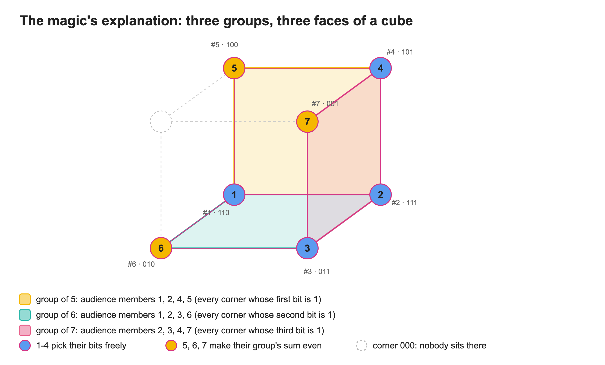
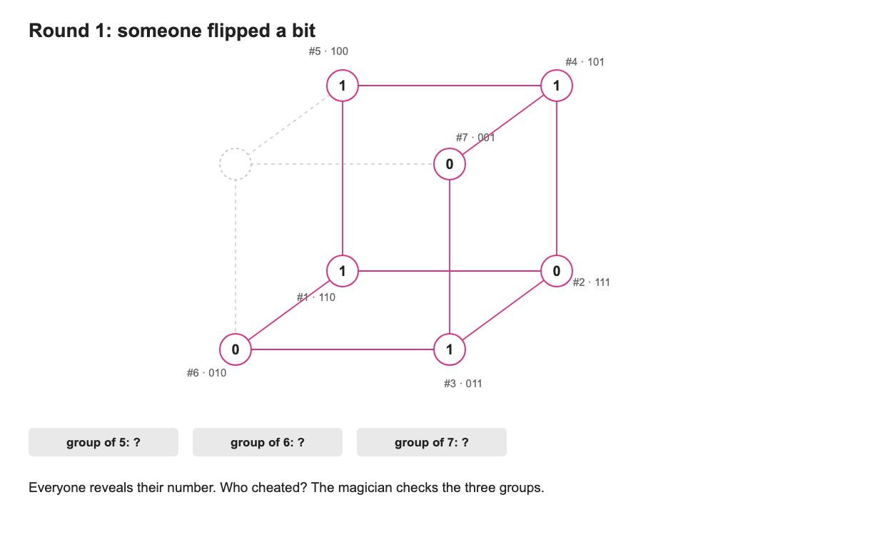
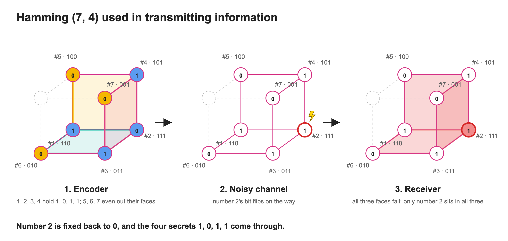
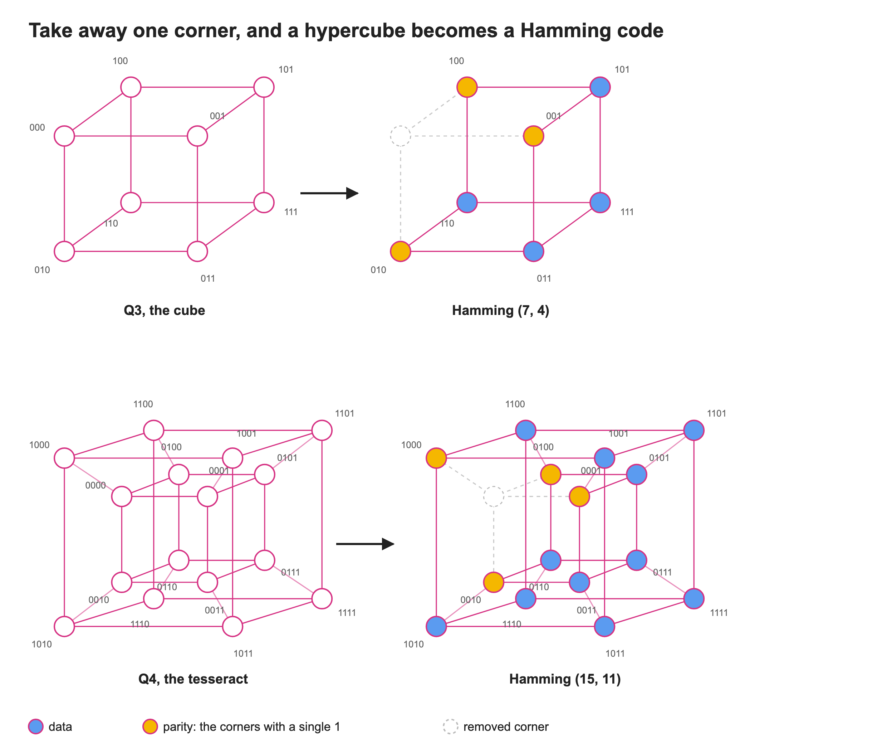
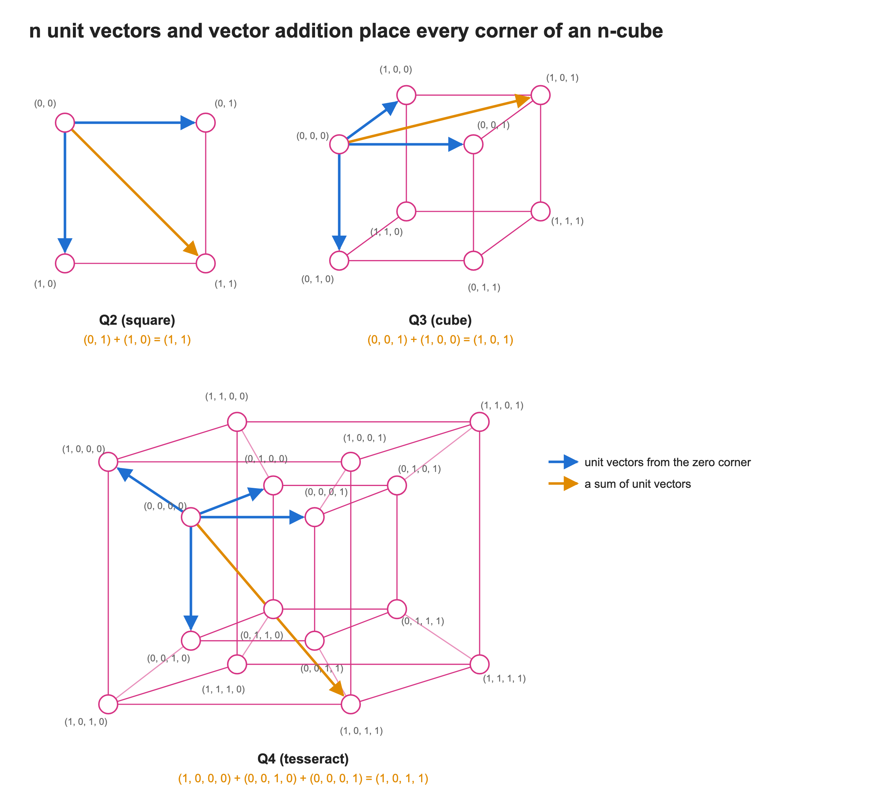
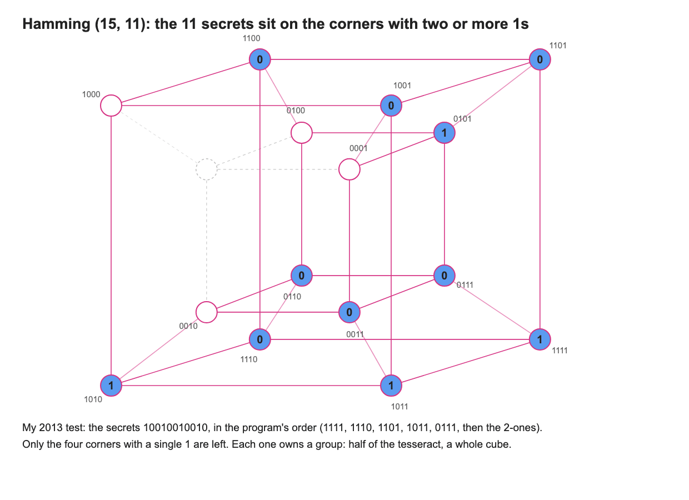
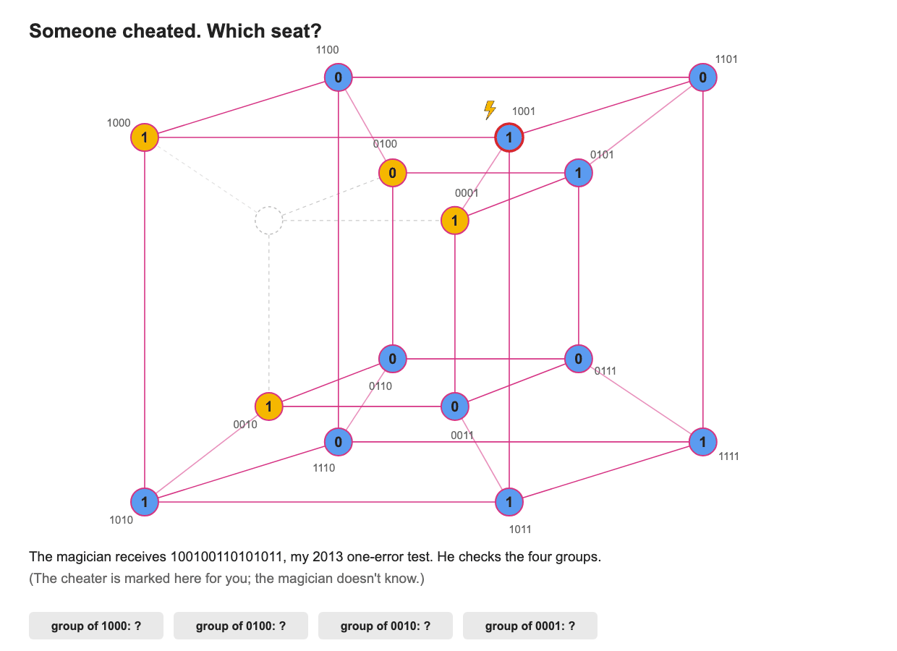
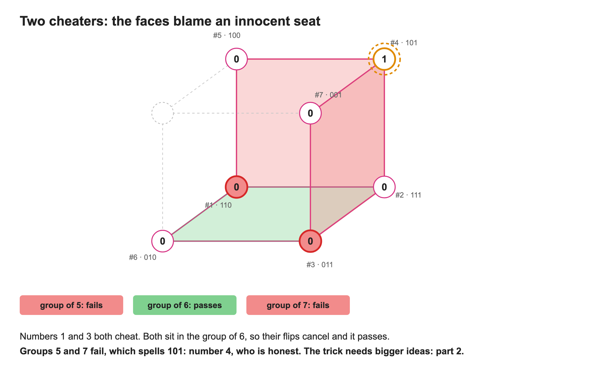

<!--
Source: original.pdf, a PDF export of the Word document (in OneDrive) published to the
"Intuitive Information" blog on 2013-04-01. Revised 2026-10: proofread, figures redrawn to match
part 2 (scripts in source/), and the unfinished ending (it stopped at "The Q4 is which has 4
groups") completed with the tesseract and a lead-in to part 2.
-->

*Revised in 2026: the figures are redrawn to match part 2, and the unfinished ending is completed. The rest is the April 2013 post, lightly proofread.*

Ok, want to play a game? Let's say you are pretending to be a magician, and there are 7 people in your audience.

1. Setting up:
    1. Number your audience members from 1 to 7.
    2. Ask the ones numbered 1, 2, 3 and 4 to each think of a binary number, either 0 or 1, and to tell the others but not you.
    3. Then number 5 adds up the binary numbers of those numbered 1, 2 and 4. If the result is even, he or she picks 0; otherwise, 1. Similarly, number 6 does the same with numbers 1, 2 and 3, and number 7 with numbers 2, 3 and 4.
    4. Ask them to talk it over as a group and choose at most one person to cheat on you. That person decides whether to flip his or her binary number or not.

    Remember: they do all this secretly, without letting you know what binary number anyone is holding.

2. The game starts: ask everyone to reveal the number they are holding. After thinking for a few seconds, you say: "You, number 5, are cheating on me!" if one of them actually flipped the number; otherwise, "Well, thanks for not cheating on me." That's magic.

If you are interested in this 'magic' trick, read on. If you already know what's behind the scenes and want to know how I would take this trick to 2n − 1 audience members, read on too. Otherwise, just close this browser tab.

## Trick's explanation

So, how can we figure out whether one of our audience members is cheating? Generally speaking, the rest of the audience is helping us. Whether they are numbers 1–4, who pick any binary number they like, or numbers 5–7, whose numbers depend on the first group, every one of their numbers carries some information that lets the whole group correct itself when one of them goes wrong. That's teamwork talking.

Technically speaking, let's say numbers 1 to 4 came up with the bits 1, 0, 1 and 1. Following the rules above:

- Number 5 holds 0, since bit1 + bit2 + bit4 = 1 + 0 + 1 = 2, which is even.
- Similarly, number 6 holds 0: bit1 + bit2 + bit3 = 1 + 0 + 1 = 2.
- And number 7 holds 0 as well: bit2 + bit3 + bit4 = 0 + 1 + 1 = 2.

Say the group picked number 5 to be the liar. If he didn't flip anything, all the rules above still hold. If he did, bit5 no longer satisfies its rule. We can't say 5 is the liar right away, because the liar could just as well be 1, 2 or 4 (remember, there's only one liar). However, numbers 6 and 7 still satisfy their rules, so 1, 2 and 4 are not the liar. That leaves 5. Confused yet? Try another explanation, with the figure below:

The audience is divided into 3 groups, arranged as in figure 1. We go through the rules one group at a time and find that the group of 1, 2, 4 and 5 has a problem, but the other two are fine. Number 5 is the only one in that group who doesn't belong to the other groups, so he is definitely the liar.

Would this still work if the liar were someone other than number 5? Yes, it would, because the arrangement lets us identify every audience member by which of the 3 groups they belong to. For instance, number 2 is the only one in all 3 groups, and number 4 is the only one in the groups of 5 and 7 but not 6 (see figure 1). Here is the magician at work, once with number 5 cheating and once with number 4:

The gist of the trick is the way we arranged the audience in a special graph, where everyone can cross-check the others in their group.

**Naysayers:** Well, I could do the same trick without your graph. I'd just put 3 audience members in a group and let one of them pick a binary number for the whole group. If one of us lied, you would know right away, because he or she would differ from the other two.

**Me:** Yep, you could do that. The difference between your trick and mine is the amount of redundant information added to the data so that the group can correct itself when something goes wrong.

In my trick I added 3 bits to 4 bits of data, so the information rate is 4/7, whereas you added 2 bits to just 1 bit of data, a rate of 1/3.

So it's not only the special arrangement of the audience that matters, but also how much redundant information we add. That's it for the trick. If you want to know where the special graph comes from, or whether there are other graphs with the same kind of structure, keep reading.

## Hamming Code

Now the fun part is over, but the exciting part has just started. The trick I just showed you is a visual representation of [Hamming](https://en.wikipedia.org/wiki/Hamming_code) (7, 4). Hamming codes in general are 2m − 1 bits long, where m is the number of parity bits that give the block its self-correcting ability, and 2m − m − 1 is the number of data bits.

| Parity bits | Total bits | Data bits | Name | Rate |
| --- | --- | --- | --- | --- |
| 2 | 3 | 1 | Hamming (3, 1) (triple repetition code) | 1/3 ≈ 0.333 |
| 3 | 7 | 4 | Hamming (7, 4) | 4/7 ≈ 0.571 |
| 4 | 15 | 11 | Hamming (15, 11) | 11/15 ≈ 0.733 |
| 5 | 31 | 26 | Hamming (31, 26) | 26/31 ≈ 0.839 |
| ... | | | | |
| m | 2m − 1 | 2m − m − 1 | Hamming (2m − 1, 2m − m − 1) | (2m − m − 1)/(2m − 1) |

*Source: Wikipedia*

In information theory, the Hamming code is the classic linear error-correcting block code that can correct one-bit errors (as you saw in the game, where the group corrected itself). The code has several kinds of representations, such as matrix, algebraic, polynomial, trellis and Tanner graph [1]. But none of them is **intuitive** enough to explain how to encode and decode naturally. And of course, "If you can't explain it simply, you don't understand it well enough," as the quote usually credited to Albert Einstein goes. That's why I am bringing this very classic information theory problem up again in this blog. I hope my explanation of the Hamming code is simpler in some ways, so that it can be the ground for future development later on.

The self-correcting mechanism in figure 2 is quite easy to follow once you've mastered the 'magic' trick, isn't it? However, readers with sharp eyes will notice that the arrangement of bits looks like a cube missing one corner and its 3 edges. Not just that: a Hamming code with m parity bits is 2m − 1 bits long. We could guess that a hypercube would be perfect for this kind of special arrangement.

## Hypercube

Generally speaking, a *hypercube* is a cube in n-dimensional space. To keep it simple, we will use a *unit hypercube* (hypercube for short), whose sides are one unit long. You can find a detailed definition [on Wikipedia](https://en.wikipedia.org/wiki/Hypercube); however, I want to point you to another definition, which describes the most important property of the hypercube: *"An n-dimensional hypercube, or n-cube, denoted by Qn, is a graph that has vertices representing the 2n bit strings of length n. Two vertices are adjacent if and only if the bit strings that they represent differ in exactly one bit position."* [2]

To build an n-cube, we first place the zero vector and the n unit vectors, n + 1 bit strings of length n, and then use vector addition to place the other 2n − n − 1 bit strings. That sounds familiar from the definition of Hamming codes, doesn't it?

That's enough of an introduction to hypercubes and Hamming codes.

## How to use the hypercube to build Hamming codes

After reading this far, some of you have probably figured out the relationship between Hamming codes and n-cubes. Let me go straight to the point. To build an encoder and a decoder for a Hamming code of length 2n − 1 bits, we need a special graph made of n groups, each with 1 parity bit, in which every bit (vertex) has a distinct position relative to the groups.

An n-cube with one vertex and its n edges removed is exactly such a graph. The magic trick above proves it for the 3-cube. Give every audience member the name of their corner, and leave corner 000 empty:

| Audience member | Corner | Groups they sit in |
| --- | --- | --- |
| 2 | 111 | all three |
| 1 | 110 | 5, 6 |
| 4 | 101 | 5, 7 |
| 3 | 011 | 6, 7 |
| 5 | 100 | 5 only |
| 6 | 010 | 6 only |
| 7 | 001 | 7 only |

Each group is a face of the cube: the group of 5 is every corner whose first bit is 1, the group of 6 every corner whose second bit is 1, and the group of 7 every corner whose third bit is 1. So a corner's name tells you exactly which groups it sits in. It's an address. When one person cheats, the groups that fail spell out the cheater's corner: in the animation above, groups 5 and 7 failed and 6 passed, which reads as 101, number 4's corner.

## Let's do it with the Q4 (tesseract)

The tesseract is drawn the usual way, as a small cube inside a big one: the inner cube holds the corners whose names start with 0, the outer cube those starting with 1, and every corner is joined to its twin. Remove corner 0000, and 15 seats are left. That's Hamming (15, 11) from the table.

The 4 parity seats are the corners with a single 1 in their name: 1000, 0100, 0010 and 0001. Each one owns a group: every corner that has a 1 where it has its 1. On the cube those groups were faces; on the tesseract each one is half of the tesseract, a whole cube. The other 11 seats hold the data, and each parity seat makes its cube even. Here is my program from 2013 encoding its test message, 10010010010:

Catching a cheater works exactly like on the cube. A group fails when the cheater sits in it, so the failing groups spell out the cheater's name. In my program's one-error test, seat 1001 flips its bit: the groups of 1000 and 0001 fail, and 1001 is caught.

The same works for any n: the n-cube minus one corner gives n groups, one per direction, and every seat's name is its address. That's every row of the Hamming table above, drawn as a hypercube.

## What if two people cheat?

The trick has one weakness. Let's say numbers 1 and 3 both cheat. Both sit in the group of 6, so their two flips cancel out and that group passes. Groups 5 and 7 fail, which spells 101, and the magician points at number 4, who is innocent.

Catching more cheaters needs more redundancy, and a smarter way to use the hypercube. That's the next post.

## References

1. [Hamming code](https://en.wikipedia.org/wiki/Hamming_code), Wikipedia (its representations, and the table above).
2. Rosen, K. H. (2003). *Discrete mathematics and its applications*. Boston: McGraw-Hill.
