*A reconstruction. The original sequel to part 1 (April 1, 2013, first published as "Just another generalized version of Hamming Code – Hypercube representation") was lost. This version rebuilds it from that post and from the [ECC-HyperCube](https://github.com/bomot113/ECC-HyperCube) code that followed it (first commit August 29, 2013). The ideas are the 2013 ones; the wording and examples are new.*

## Same tesseract, one level deeper

Part 1 ended with a problem. On the cube, two cheaters made the faces point at an innocent seat, and the magician blamed number 4. The tesseract version, Hamming (15, 11), has the same weakness: its four groups catch one cheater, never two.

So let's keep part 1's tesseract, with its 15 seats, corner 0000 left empty, the inner cube for names starting with 0 and the outer cube for names starting with 1, and change just one thing. Parity no longer stops at the corners with a single 1 in their name. It goes one level deeper: every corner with one or two 1s computes a parity bit, and only the five heaviest corners keep a secret. In my program that's the second parity dimension, `CubeCode(4, 2)`.

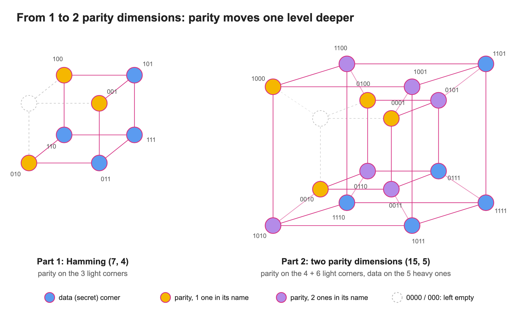

That costs secrets, 5 instead of 11, but it buys a lot: as we'll see, this tesseract catches up to three cheaters.

## Encoding: every group stays even

Every parity corner owns a group: itself, plus every corner that has a 1 wherever it has a 1. A corner with one 1, like 1000, owns a whole cube: the outer one. Those four cube groups are exactly part 1's. A corner with two 1s, like 0110, owns a square; that one links the inner and outer cubes. The rule is the same as before: each group must hold an even number of 1s.

Let's hide the secrets 1, 0, 1, 1, 0. Squares first: each two-1 corner looks at the three corners above it and evens out its square. Then each one-1 corner evens out its whole cube. The program sends the 15 bits in its own order, 101100011000110, the same answer as my 2013 test.

Here it is step by step, in the order my program computes it:

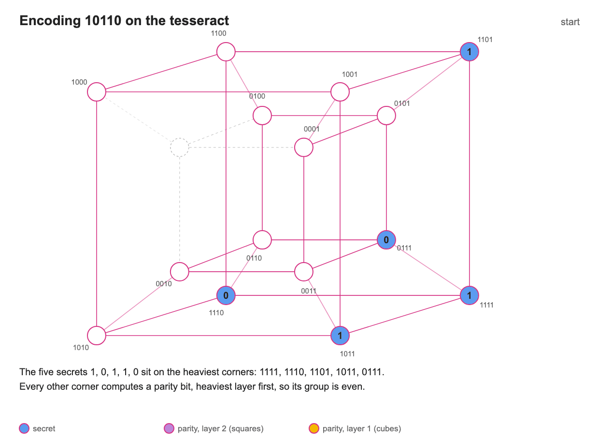

And the finished picture, with one group of each kind:

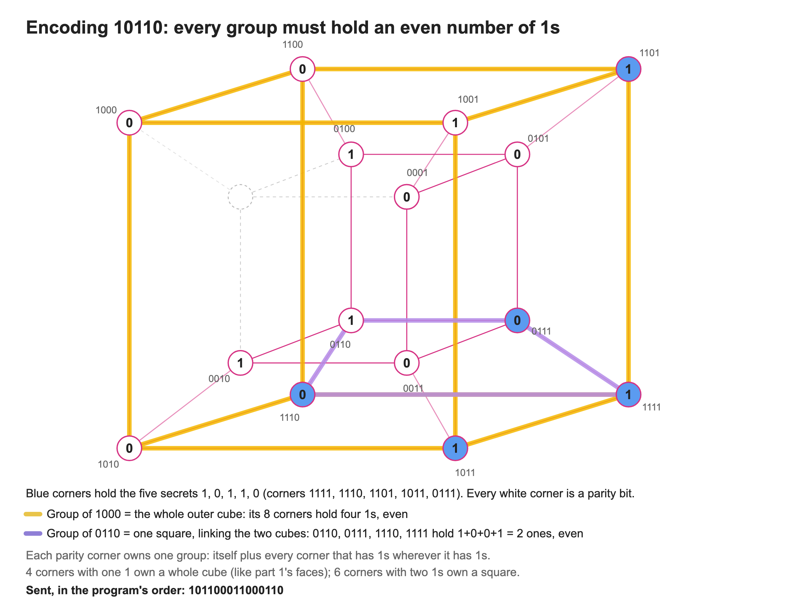

## Each parity bit watches one group

Now the heart of the trick. Each of the ten parity bits watches exactly one group: its own square or its own cube. And every seat sits in a fixed set of those groups. Call that set the seat's **fingerprint**.

In part 1 the fingerprint was simply the seat's address: corner 101 sat in the first and third faces, and nowhere else. On the tesseract fingerprints are longer. Corner 1111 sits in all ten groups, corner 1000 only in its own.

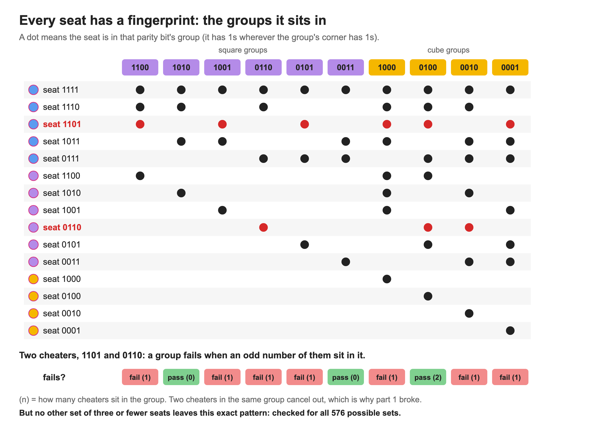

When cheaters flip their bits, a group fails exactly when an odd number of cheaters sit in it. So the failing groups are the cheaters' fingerprints laid on top of each other, and two cheaters in the same group cancel out.

Here's the good news: on the tesseract, every set of up to three cheaters leaves its own pattern. There are 576 ways to pick zero to three cheaters among the 15 seats, and they leave 576 different patterns. Read the pattern and you know exactly who cheated.

## One cheater: the pattern is its fingerprint

Let's watch the magician work. Seat 1011 cheats. He checks the ten groups one by one: six fail, and those six are exactly 1011's fingerprint. Just like in part 1, the failures spell out the cheater.

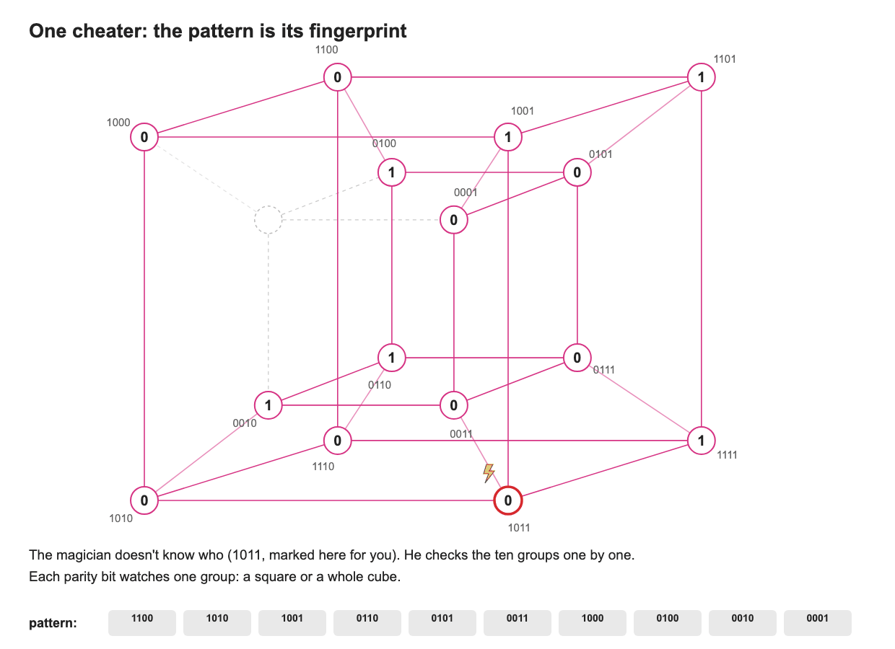

## Two cheaters: still one pattern

Now two seats cheat: 1101, who holds a secret, and 0110, who holds a square's parity. Watch the cube group of 0100. Both cheaters sit in it, so they cancel out and it passes. That's exactly how two cheaters fooled part 1.

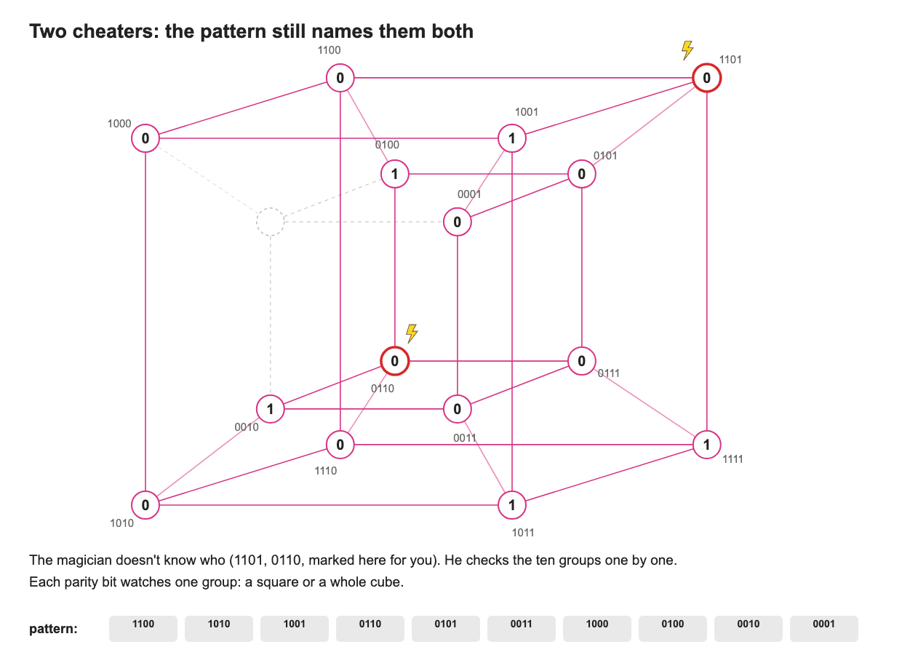

Part 1's shortcut reads only the four big groups. They spell 1011, an honest seat. But the six squares see what the cubes miss: the full pattern of ten belongs to 1101 and 0110, and to no other set of up to three seats.

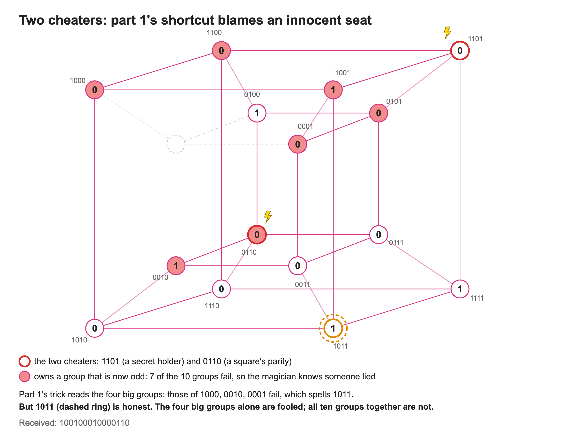

## Three cheaters: still one pattern, one answer

Three seats cheat now, straight from my program's 3-error test: 0111, 1001 and 0100. The magician receives 101110001000010 and runs the same ten checks.

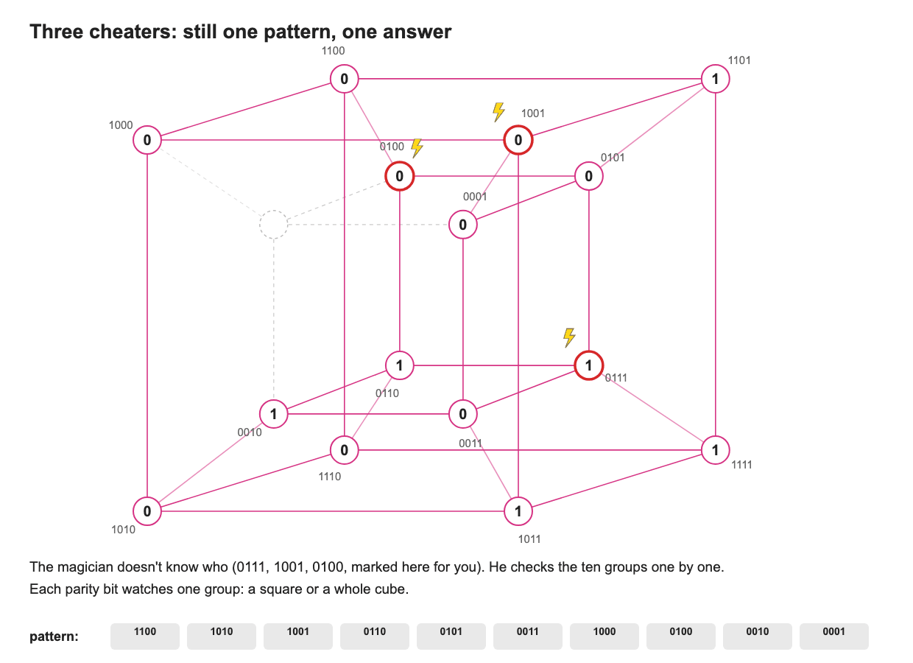

Again the four big groups alone blame an innocent seat, 1010. All ten groups together point at exactly 0111, 1001 and 0100.

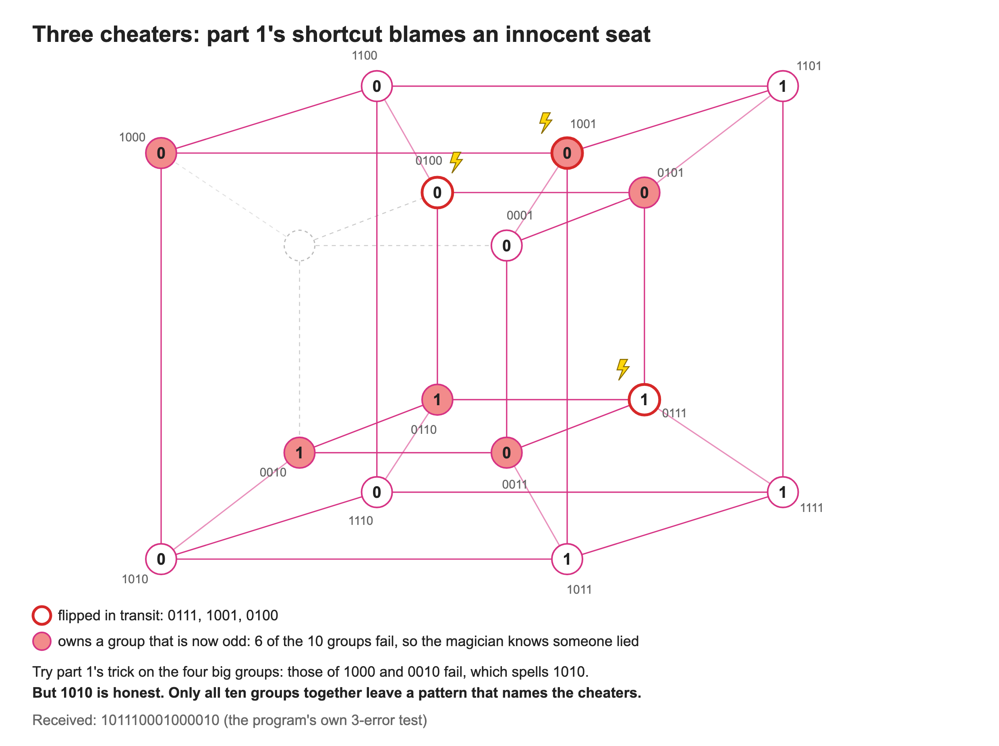

**Naysayers:** So the magician memorizes 576 patterns?

**Me:** On a tesseract he could. But the 5-cube version catches 7 cheaters and would need about 3.6 million patterns, and the 7-cube one about 95 billion. My program never builds that table. It finds the same answer by voting, using the shapes of the groups.

## Corner 1110 asks its question seven times

Take the secret corner 1110. Its own group is tiny: just the edge 1110–1111. Its question is "what is the parity of my edge?"

Here's the trick. The tesseract has seven more edges running in the same direction, the horizontal ones in the picture, and they are copies of that edge. (The eighth copy, 0000–0001, belongs to the empty corner.) Because every group was made even, in an honest seating every copy has the same parity as the original. And no corner sits on two copies, so each cheater can spoil only one answer.

Four clean edges say 1 and three spoiled edges say 0. The majority says 1. The magician still doesn't know who lied, and doesn't need to.

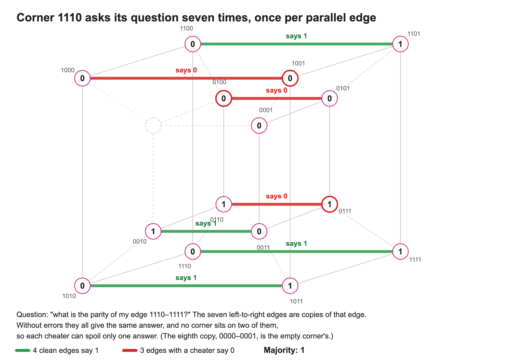

## Every heavy corner votes along its own direction

The other three corners with three 1s play the same game, each along its own direction: 1101 along the vertical edges, 1011 along the depth edges, and 0111 along the links between the two cubes. A tesseract has four directions, and there are exactly four corners with three 1s, so each one owns a direction.

Each corner gets seven answers. Three cheaters can spoil at most three of them, so every majority is right: 1110 says 1, 1101 says 0, 1011 says 0 and 0111 says 1.

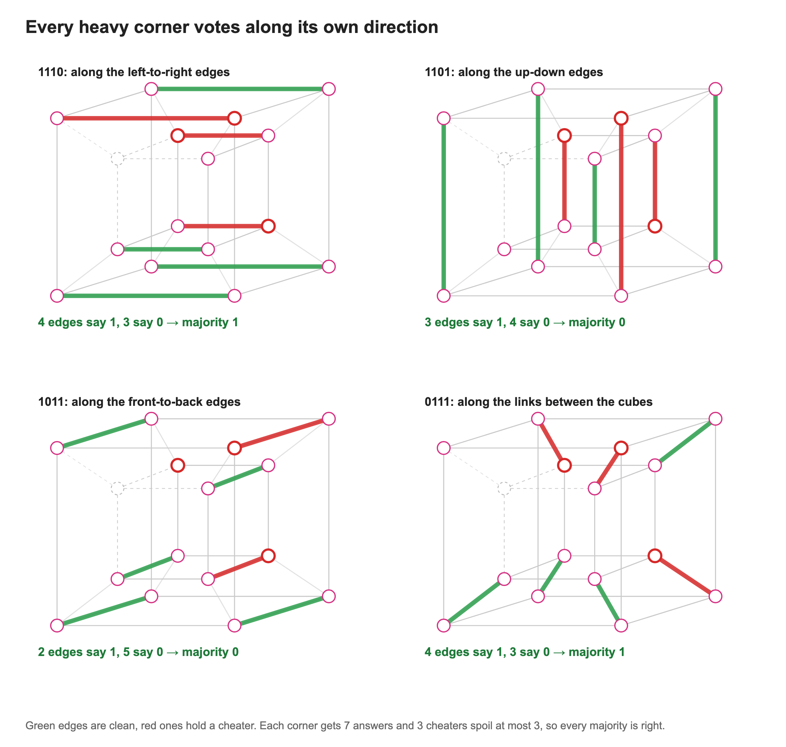

## The last question, and the secrets come back

One secret corner is left: 1111, the heaviest, whose group is just itself. Before it asks, the magician takes the four answers out of the picture, flipping the corners those answers account for. What's left at every corner is just 1111's own bit, so seven single corners answer. Six say 1 and the liar at 0111 says 0, so corner 1111 is 1.

Now each secret is one step away: a heavy corner's secret is its edge's answer combined with 1111's bit. Out come 1, 0, 1, 1, 0, exactly what was sent, with three of the fifteen seats lying.

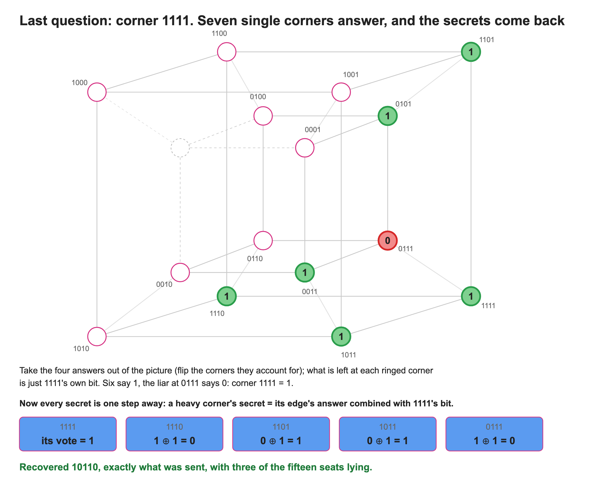

## Naming the cheaters

The magician has the secrets back, but the trick isn't finished until he points at the cheaters. That's the easy part now: once the secrets are known, the honest seating is known too.

Back to the two cheaters from before. The votes win by wide margins, 5–2 or 6–1, and give back 10110. The magician encodes 10110 again and compares it with what every seat said. Exactly two seats disagree, 1101 and 0110: those are the cheaters, named without guessing.

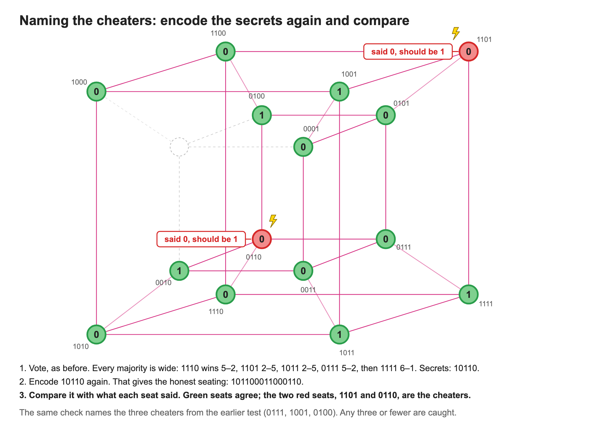

The same check names the three cheaters from the earlier test, 0111, 1001 and 0100. Any three or fewer get caught.

It's the same answer the pattern of failing groups gives. Voting is just the fast way to find it.

That's the whole pattern. Part 1 put parity one level deep and caught one cheater. Part 2 puts it two levels deep and catches three. One more level on the 5-cube catches seven, and that is the code that sent Mariner 9's pictures of Mars back in 1971. The family has a name, Reed–Muller codes, and the hypercube shows why they work.

## From the blog to code

The trick became [ECC-HyperCube](https://github.com/bomot113/ECC-HyperCube), written in C++ between August and October 2013. Its classes are this post's words: a `HyperCube`, a `UnitCube` per corner, and `parallelHCubes` for the witnesses. One parameter, the parity depth m − r − 1, picks the code: depth 1 gives part 1's Hamming code, depth 2 gives this post's.

## References

1. Bui, T. (2013). Catching a cheater with a cube: Hamming codes on the hypercube (part 1). *Intuitive Information*. First published as "Just another generalized version of Hamming Code – Hypercube representation".
2. Reed, I. S. (1954). A class of multiple-error-correcting codes and the decoding scheme. *Transactions of the IRE Professional Group on Information Theory*, 4, 38–49.
3. Muller, D. E. (1954). Application of Boolean algebra to switching circuit design and to error detection. *Transactions of the IRE Professional Group on Electronic Computers*, EC-3.
4. Abbe, E., Shpilka, A., Ye, M. (2021). [Reed–Muller codes: theory and algorithms](https://arxiv.org/abs/2002.03317). *IEEE Transactions on Information Theory*, 67(6).
5. [Hadamard code](https://en.wikipedia.org/wiki/Hadamard_code), Wikipedia: RM(1, 5) and the Mariner 9 "Green machine".
6. Rosen, K. H. (2003). *Discrete mathematics and its applications*. Boston: McGraw-Hill (hypercube definition, as in part 1).
